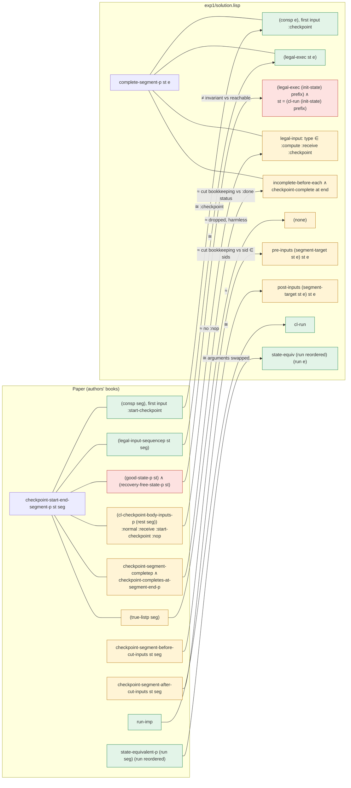
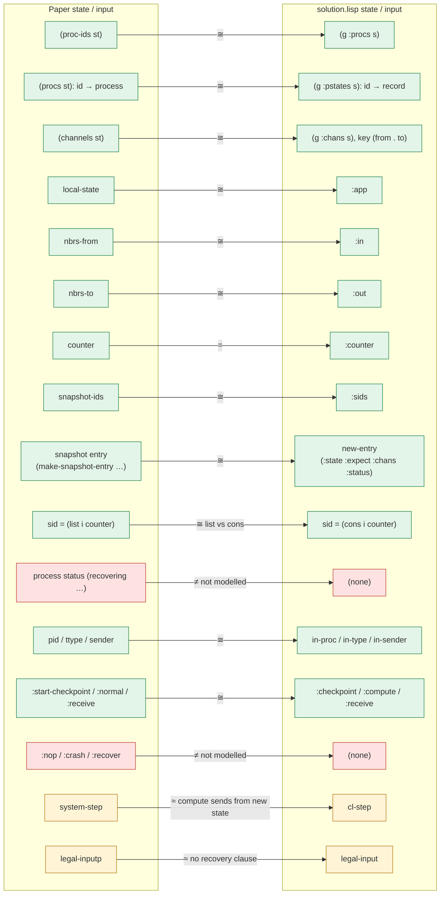
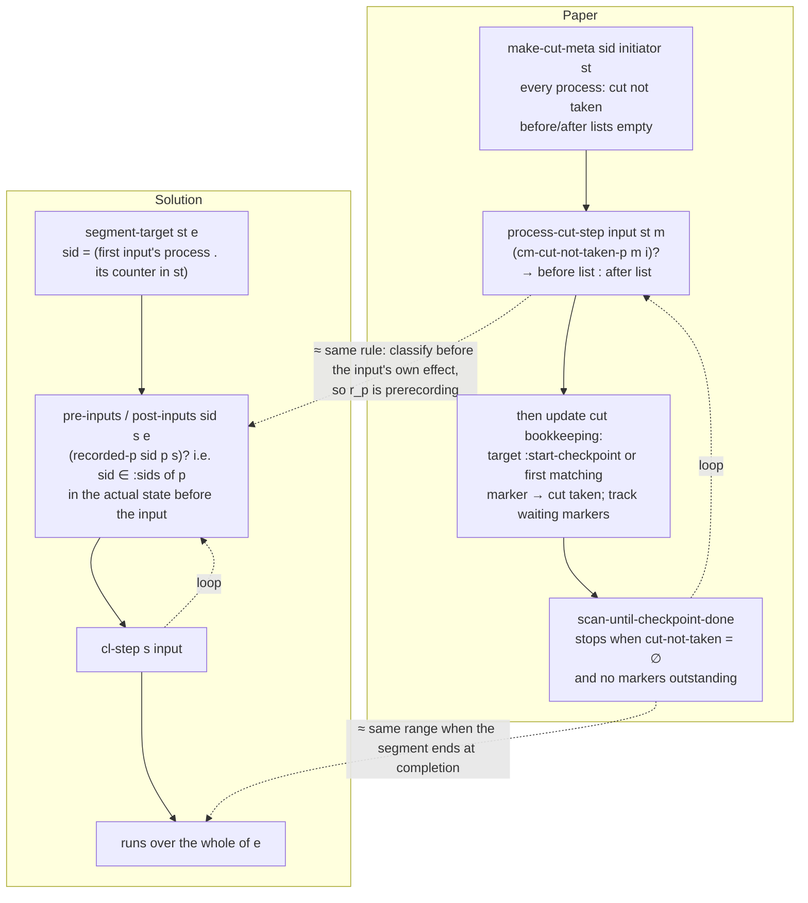

# 04 Chandy–Lamport: the paper's main theorem vs `exp1/solution.lisp` `MAIN`

This compares the paper's global reordering theorem with the experiment-1 solution's `MAIN`, and maps each paper
definition it depends on to the solution's counterpart. "Paper" means the authors' books
(`source/authors-books/`). The PDF (§5.3, p. 12) prints a shortened `checkpoint-start-end-segment-p`; the authors'
README says some predicates are omitted from the printed code.

## The two statements

**Paper:** `checkpoint-complete-segment-reordered-run-state-equivalent` (`global_reorder.lisp:5748`)

```lisp
(implies (checkpoint-start-end-segment-p st input-seg)
         (state-equivalent-p
          (run-imp st input-seg)
          (run-imp st (append (checkpoint-segment-before-cut-inputs st input-seg)
                              (checkpoint-segment-after-cut-inputs  st input-seg)))))
```

**Solution:** `MAIN` (`exp1/solution.lisp:741`)

```lisp
(implies (and (legal-exec (init-state) prefix)
              (equal st (cl-run (init-state) prefix))
              (complete-segment-p st e))
         (state-equiv
          (cl-run st (append (pre-inputs  (segment-target st e) st e)
                             (post-inputs (segment-target st e) st e)))
          (cl-run st e)))
```

Both say the same thing: if `e` is a complete checkpoint segment from `st`, then running its prerecording inputs
followed by its postrecording inputs from `st` gives a state equivalent to running `e`. Two things differ: the
**condition on the starting state** (an invariant in the paper, reachability in the solution) and **how
pre/post and completion are computed** (separate bookkeeping in the paper, the actual process state in the
solution).

## Visual: theorem-level map

Legend for edge labels:
- **=** same meaning, same structure.
- **≅** same meaning, renamed or encoded differently.
- **≈** corresponds, but defined by a different mechanism (not proved equivalent).
- **≠** a real difference.



## Visual: state and inputs



## Visual: how pre/post is decided



## Mapping table

| Paper | Solution | Relation | Note |
|---|---|---|---|
| `checkpoint-complete-segment-reordered-run-state-equivalent` | `MAIN` | ≅ | Same shape. The solution's arguments to the equivalence are swapped, which doesn't matter because equivalence is symmetric here. Internally the solution proves the two final states **equal** (`reorder-from-state`, `:728`). |
| `checkpoint-start-end-segment-p` | `complete-segment-p` + prefix hypotheses | see rows below | |
| `(consp seg)`, `(equal (ttype (first seg)) :start-checkpoint)` | `(consp e)`, `(eq (in-type (car e)) :checkpoint)` | ≅ | |
| `(true-listp seg)` | — | ≈ | Dropped. `cl-run` and `legal-exec` stop at the first non-cons, so it doesn't matter. |
| `(legal-input-sequencep st seg)` | `(legal-exec st e)` | ≅ | Same recursion: legal first input, then the rest legal from the next state. |
| `legal-inputp` | `legal-input` | ≈ | Receive: same four conditions. Checkpoint: paper adds "no process recovering", which has no counterpart because the solution has no recovery. Normal/compute: valid process in both. |
| `(cl-checkpoint-body-inputs-p (rest seg))` | type check inside `legal-input` | ≈ | The paper allows `:nop` in the body; the solution has no `:nop`. Both exclude crash and recovery. |
| `(good-state-p st)` ∧ `(recovery-free-state-p st)` | `(legal-exec (init-state) prefix)` ∧ `st = (cl-run (init-state) prefix)` | **≠** | Paper: *any* state satisfying the structural invariant (unique ids, consistent in/out neighbours, well-formed channels, stored sids below counters) and with no recovery. Solution: states *reachable* from a fixed initial state. The paper never defines `good-state-p` in the text, so the prompt substituted reachability (harness note 1). |
| `checkpoint-segment-completep` ∧ `checkpoint-completes-at-segment-end-p` | `incomplete-before-each` ∧ `checkpoint-complete` at the end | ≈ | Both mean "incomplete on every proper prefix, complete at the end". Paper's "complete" is `checkpoint-collection-complete-p` on its bookkeeping: every process has taken its cut and no target markers are outstanding. Solution's "complete" is that every process holds the sid with status `:done`, and `:done` is set exactly when no markers remain expected. They match in intent; no proof connects them. |
| `checkpoint-segment-sid` = `(list i (counter p))` | `segment-target` = `(cons i (nfix counter))` | ≅ | Different encoding of the same pair. |
| `checkpoint-segment-before-cut-inputs` | `pre-inputs` | ≈ | Paper: a scan with separate cut bookkeeping (`make-cut-meta`, `process-cut-step`), proved consistent with the real state (`cut-meta-imp-consistent-p`). Solution: reads `sid ∈ :sids` from the real state. Both classify an input *before* its own effect, so r_p is prerecording. Paper scans only until completion; solution scans all of `e`. Same result when `e` ends at completion. |
| `checkpoint-segment-after-cut-inputs` | `post-inputs` | ≈ | As above. |
| `run-imp` | `cl-run` | ≅ | |
| `system-step` | `cl-step` | ≈ | Same transitions for checkpoint, marker and receive. Compute: the paper sends from the old local state, the solution from the new one (prompt leaves this open). No crash, recover or nop in the solution. |
| `state-equivalent-p` | `state-equiv` | ≅ | Field by field: `proc-ids`↔`:procs`; `channels`↔`:chans`; `local-state`↔`:app`; `nbrs-from`↔`:in`; `nbrs-to`↔`:out`; `counter`↔`:counter`; `snapshot-ids`↔`:sids`. Snapshot entries are not compared in either. |

## What the differences mean for the theorem

1. **Starting state (≠). Neither version covers the other.** The paper's theorem holds for every well-formed,
   recovery-free state, including states it never shows are reachable. The solution's holds only for reachable
   states, but over an arbitrary topology: no uniqueness of ids and no in/out consistency. The paper's
   `good-state-p` requires both. In the parts both models share, every reachable state should satisfy the paper's
   invariant (that is the point of the invariant), so on reachable states the solution's version is the narrower
   one. This was the prompt's choice (harness note 1), not the model's.
2. **Classification and completion (≈).** The paper keeps separate bookkeeping and proves it matches the real
   state. The solution reads the real state directly. That's simpler, and arguably closer to the prompt's English
   ("whether its process has already taken its cut"). No proof shows the two definitions agree. For `MAIN`'s
   truth this matters little, since the solution's key lemma holds for *any* snapshot id and *any* legal
   execution (see `04-binmonjil-chandy-lamport-exp1.md`, item 1).
3. **Conclusion (≅, stronger).** Same equivalence relation and the same reordered execution. The solution
   actually proves equality of the final states.
4. **Model scope (≠, out of scope).** The paper models crash, recovery and `:nop`. The theorem itself excludes
   crash and recovery (`recovery-free-state-p`, `cl-checkpoint-body-inputs-p`). The solution leaves all three out
   of the model.
